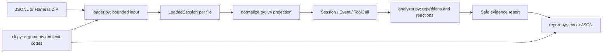

# Architecture

AgentGuard Bench v0.1 is a single-process offline pipeline. There are no runtime dependencies
outside Python's standard library, no Harness execution and no network calls.

## Modules

| Module | Responsibility |
|---|---|
| `models.py` | Internal typed records, safe input errors and configurable resource limits |
| `loader.py` | Stream UTF-8 JSONL, identify sessions, validate ZIP metadata, enforce budgets |
| `normalize.py` | Validate relevant envelopes, project fields, correlate results, identify boundaries |
| `jsonutil.py` | Strict JSON decoding and deterministic argument identity |
| `analyzer.py` | Pure behavioral observations and safe evidence projection |
| `report.py` | Text / JSON serialization of the safe projection only |
| `cli.py` | Parse options, invoke pipeline, present diagnostics and return exit codes |

The loader handles input failures atomically. Each JSONL has exactly one header; the ZIP
returns multiple independent `LoadedSession` records. Duplicate session IDs are refused
instead of accidentally combining generations. Attachments are not read or extracted.

Normalization validates contiguous sequence numbers from zero and the known v4 event
vocabulary. Unknown non-ignorable events fail closed. It is deliberately a projection,
not a replacement for Harness's complete schema validator or surface reconstruction.
The current turn and step come from lifecycle markers when absent from a relevant event;
for example `user/message` is a flat message without turn/step in its payload.
`data.callId` pairs with `data.message.toolCallId` inside the same session and tool step.
Call IDs can recur after settlement in another step. Explicit `sourceEventSeqs` references
are checked against the cited call; absent coordinates permit only an unambiguous match.
Duplicate calls in one scope, conflicting coordinates/sources and duplicate execution
results are refused; missing results remain unknown. Result surface replacements are
counted as events and boundaries, without replacing the observed execution outcome.
Only lifecycle markers update active turn/step context: an old result being rewritten
must not move a later flat user message into that result's historical step.

Behavioral analysis excludes the fork-inherited prefix before the last tagged
`session/end-seed` marker. Untagged resume markers reset local repetition context.
Synthetic user-role context does not reset it, while a real user prompt does. Surface
replacements, unverified inbox edits and PTC dispatches reset the context because this MVP
does not reconstruct their complete model-visible effect. Warnings identify those boundaries.
The normalizer recognizes one verified exception: guard-only next-step enqueue and full
claim, followed by admission of the exact same identified messages in the next step.
Those queue records preserve context; only the direct user messages count as reminders.
Canceled, mixed, malformed or unmatched queue edits remain conservative boundaries.

Tool identity is `(tool name, canonical arguments)`. JSON nodes receive type tags and
object keys are recursively sorted; arrays preserve order. Numeric spelling is retained
to avoid float-rounding collisions. Invalid/ambiguous JSON uses an explicitly tagged
raw Unicode string fallback. Canonical values stay in memory. Reports expose only
session-local action labels, never argument previews or argument fingerprints.

For each structured reminder, the analyzer inspects the previous tool batch. One observed
identity, a completed step, completed results and a repeated streak allow a conservative
inferred baseline. Distinct or insufficient candidates yield unknown attribution.
The first following call determines the headline reaction; up to K calls retain separate
comparisons. The next reminder or a behavioral boundary closes the observation window.

Sequence and per-step indexes avoid a full log scan per reminder. A normal session takes
O(events + calls + reminders × log(events) + emitted evidence), excluding argument parsing
and sorting. Candidate evidence is capped at 20 sequence numbers with an explicit total
and truncation flag. Post-reminder windows end at the next reminder, bounding overlap.
Memory scales with parsed input and report size, not just compressed file size.

## Tradeoffs

1. **Pin v4 instead of guessing migrations.** Older/future formats fail explicitly.
   Adapters can be added after inspecting their source contracts and tests.
2. **Conservative attribution instead of fabricated trigger links.** Batch ambiguity and
   missing evidence yield `UNKNOWN`; coverage is lower, claims are more defensible.
3. **Store bounded input in memory instead of a streaming analysis database.** This keeps
   result pairing and later evidence inspection simple. Resource budgets are necessary,
   and byte limits are not hard process-memory limits.

Future experiment execution can produce `Session` inputs and independently assessed
task outcomes without changing parsing or report rendering. There is intentionally no
generic plugin registry or experiment abstraction in this version.

## Other repository files

- `src/agentguard/__init__.py` defines the package version; `__main__.py` delegates
  `python -m agentguard` to `cli.main()`.
- `pyproject.toml` defines packaging, the console entry point, developer dependencies
  and pytest/Ruff configuration. `.gitignore` excludes build products, virtual environments
  and private logs. `LICENSE` supplies the project's MIT license.
- `tests/conftest.py` builds synthetic traces and temporary files. `test_loader.py` checks
  bounded input and archive handling; `test_normalize.py` covers scoped pairing and historical
  context; `test_analysis.py` covers behavioral rules; `test_cli.py` checks CLI behavior;
  `test_audit.py` adds independent metric, isolation, privacy and purity regressions.
- `tests/fixtures/synthetic-{ignored,changed,interrupted}.jsonl` contain small committed
  scenarios. They are synthetic fixtures, not independently observed user sessions.
- `examples/synthetic-session.jsonl` is the public demonstration input;
  `synthetic-report.{txt,json}` are reproducible CLI outputs.
  `make_synthetic_zip.py` combines fixtures in a Harness-style archive without overwriting
  an existing output. The archive's descendant header records its parent relationship.
- `README.md` is the install/use entry point. `harness-contract.md` records upstream
  evidence, `limitations.md` bounds interpretation, `metrics.md` defines every reported
  count/label, and `audit-v0.1.md` records verification and remaining release gates.
